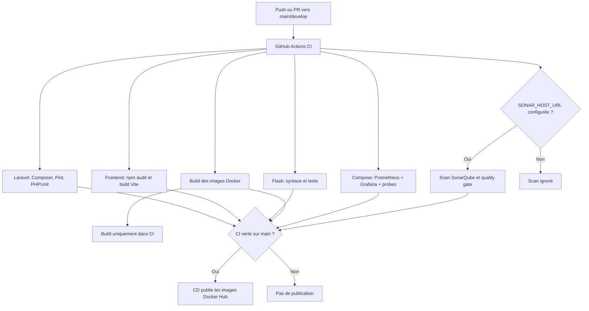

# CI/CD AquaSecure

## Architecture

La CI s'exécute sur les pushs et PR vers `main` ou `develop`, et manuellement. Elle vérifie Laravel/PHP, le frontend Vite et l'API Flask, construit les deux images Docker sans les publier, et démarre le profil d'observabilité pour vérifier Prometheus et Grafana. Après une CI réussie sur `main`, le CD publie les images applicatives sur Docker Hub avec les tags `latest` et le SHA exact testé. Le scan SonarQube s'ajoute lorsque `SONAR_HOST_URL` est configurée dans les variables GitHub.

## Docker local

Docker Desktop doit être démarré. Le Compose démarre Laravel/Apache et le classificateur Flask. Le profil `observability` ajoute Prometheus, Grafana et Blackbox Exporter. Les probes mesurent disponibilité et latence HTTP des endpoints `/up` et `/health` ; aucun métrique métier, CPU ou mémoire n'est instrumenté.

1. Copier `.env.example` vers `.env` si nécessaire. Dans `.env`, générer une clé avec `php artisan key:generate --show` et définir `APP_KEY`, puis choisir un mot de passe fort pour `GRAFANA_ADMIN_PASSWORD`. Le mot de passe reste dans le `.env` local ignoré par Git.
2. Depuis la racine du dépôt, lancer `docker compose --profile observability up --build -d`.
3. Accéder à AquaSecure sur `http://localhost:8080`, Prometheus sur `http://localhost:9091` et Grafana sur `http://localhost:3001`. Les ports sont configurables avec `AQUASECURE_HTTP_PORT`, `PROMETHEUS_PORT` et `GRAFANA_PORT`.
4. Le volume SQLite est initialement vide. Exécuter les migrations seulement après revue du schéma : `docker compose exec web php artisan migrate`. Aucun seed ni migration n'est lancé automatiquement.
5. Arrêter les conteneurs avec `docker compose --profile observability down`.

Le Compose est destiné au poste local. Il ne publie pas les images et n'est pas une configuration de production.

## SonarQube

Configurer dans **Settings → Secrets and variables → Actions** :

- Secret `SONAR_TOKEN`: jeton d'analyse associé au projet `aquasecure`.

Le job utilise `http://localhost:8888` et tourne sur le runner auto-hébergé Windows du dépôt, uniquement pour `main` hors pull requests. Configure le secret `SONAR_TOKEN` avec un jeton d'analyse du projet `aquasecure`. Le runner doit rester démarré et avoir accès au conteneur SonarQube sur le port 8888. Les scans de pull requests sont volontairement exclus pour éviter d'exécuter du code non fiable sur le runner personnel.

Le fichier `sonar-project.properties` définit les sources et exclusions. SonarQube local n'est pas automatiquement connecté à GitHub Actions.

## Publication Docker Hub

Le workflow CD publie `aquasecure-web` et `aquasecure-classifier` dans le compte configuré après une CI réussie sur `main`. Dans **Settings → Secrets and variables → Actions**, créer :

- Variable `DOCKERHUB_USERNAME`: nom du compte Docker Hub.
- Secret `DOCKERHUB_TOKEN`: nouveau jeton Docker Hub avec le droit de pousser les images.

Ne pas mettre le jeton dans `.env`, le workflow ou le dépôt. Le jeton précédemment collé dans la conversation doit être révoqué et remplacé avant de configurer le secret. Les PR, les CI échouées et la branche `develop` ne publient aucune image.

## GitHub Actions et CD

La CI utilise les outils et fichiers de verrouillage du dépôt. L'artefact `vite-build` est conservé sept jours. Aucune vraie clé API n'est fournie à la CI. `composer audit` et `npm audit` bloquent la pipeline sur leurs alertes configurées.

Le CD s'exécute après la fin de la CI, mais ne publie que si la CI est réussie sur `main`. Il construit et pousse les deux images vers Docker Hub; il ne déploie pas l'application sur un serveur.

Le job `Prometheus and Grafana stack` démarre le profil Compose `observability`, vérifie les endpoints de santé Prometheus/Grafana, puis détruit les conteneurs et volumes temporaires du runner. Les services sont également disponibles en local avec `docker compose --profile observability up --build -d`.

## Limites et résultats de validation

- Les migrations `2026_10_18_000000_align_technician_profiles_on_users_table.php` et `2026_10_20_000007_consolidate_technicians_into_users.php` ont été corrigées pour conserver la table de profils tant que le code applicatif l'utilise, et pour ne remapper les clés qu'après copie des profils. Les suites liées aux infrastructures, maintenances, recommandations IA, pagination et pilotage passent désormais.
- La suite complète garde des échecs indépendants de ce correctif, notamment le statut Ollama attendu par `AiChatTest`, certaines fonctions technicien qui ne correspondent pas encore à la consolidation des comptes, et l'envoi du mail de réinitialisation via Brevo au lieu de la notification Laravel attendue.
- Le formatage Pint a été appliqué aux fichiers PHP du dépôt ; `vendor/bin/pint --test` passe désormais localement.
- Le test Ollama attend un modèle installé et le test de réinitialisation mot de passe attend une notification Laravel alors que le modèle utilise directement Brevo.
- Le poste d'exécution n'a pas pu accéder au moteur Docker Desktop (permission refusée sur le pipe), donc les images n'ont pas été construites ici. La CI GitHub fera les builds.
- Le scanner SonarQube n'est pas installé localement ; son job dépend de la variable et du secret ci-dessus.
- Le verrou npm a été mis à jour avec `npm audit fix` ; Vite est verrouillé en version 6.4.5. `npm audit --audit-level=high` passe et trouve zéro vulnérabilité.
- `composer audit` n'a pas pu joindre Packagist depuis l'environnement réseau restreint. Le build Vite local échoue encore avec `spawn EPERM` sous Windows, donc le build doit être confirmé dans GitHub Actions.
- Validations précédentes : YAML des workflows valide ; `composer validate --no-check-publish` valide avec un avertissement de contrainte Fortify ; 6 tests Flask et 28 tests `ProjectDoctorTest` réussis. `vendor/bin/pint --test` passe après formatage du code existant. Le test de réinitialisation ciblé reste en échec comme décrit.
